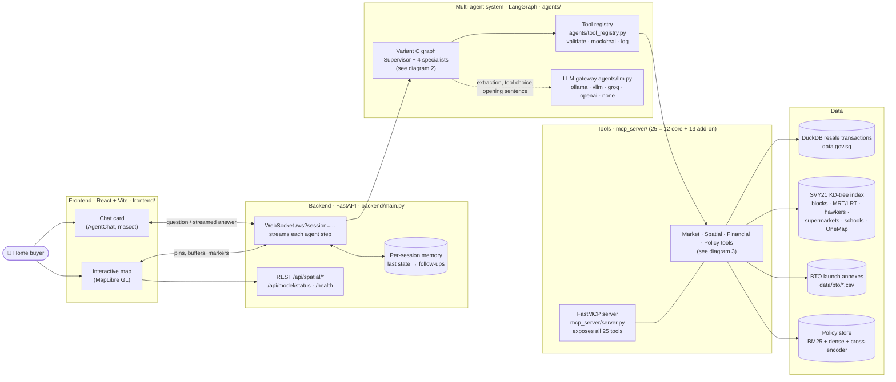
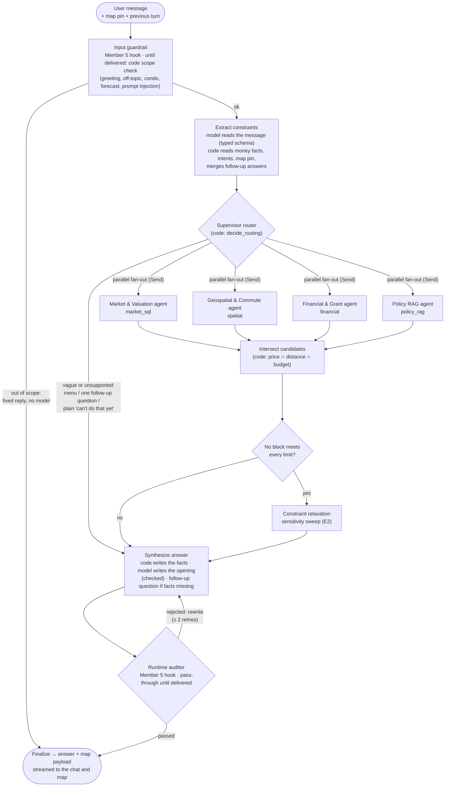
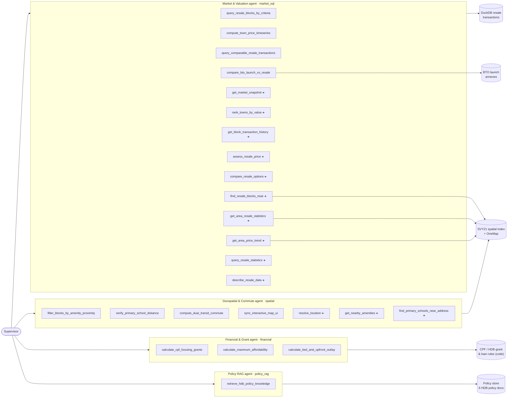

# HDB-Compass: Multi-Agent & FastMCP Decision-Support System for Singapore Public Housing

[](https://scis.smu.edu.sg)
[](https://github.com/jlowin/fastmcp)
[](https://langchain-ai.github.io/langgraph/)
[](https://maplibre.org/)
[](https://python.org)

> **HDB-Compass** is an agentic decision-support system designed to help Singaporeans navigate the high-stakes decision of buying public housing by combining multi-agent orchestration, FastMCP tool integration, and interactive geospatial intelligence.

---

## System Architecture

A high-level map of how a question travels through HDB-Compass: from the chat, through the multi-agent graph, to the tools and data behind each answer. Details of every contract are in [`docs/INTERFACES.md`](docs/INTERFACES.md).

### 1. System overview



### 2. Agent graph (Variant C: Supervisor + 4 specialists + auditor)

Every chat message runs this LangGraph state machine (`agents/arch_3_specialist_5agent.py`, nodes in `agents/supervisor.py`). Decisions marked *code* are deterministic; the model reads the message, picks tool calls inside each specialist and writes the opening sentence, and code checks what it writes.



**Inside each specialist:** a ReAct tool loop offered **only the tools this question needs** (`TASK_TOOLS` gating), with a deterministic plan as fallback when the model makes no valid call. Results become evidence only if the plan called for them (`requested_outputs`), and every call is logged (`ToolCallRecord`) for Tool F1.

**Follow-ups:** when facts are missing (money facts, which place, which school) or the question is vague, the answer ends with one question or a numbered menu, shown as clickable chips; the backend keeps the session's last state, so the reply completes the original request.

**Broad questions:** "statistics near MRT stations", "by town", "which stations are priciest", "in the east" are answered from grouped resale statistics (code-written tables), with chips to drill down from island-wide to a town, a station's area and a block's sales; other data questions go to the market agent's analysis mode. Details: `docs/INTERFACES.md` §11.

**Never an unrelated answer:** nothing defaults to the policy search any more. Policy passages are shown only for a question that names an HDB rule and only when the search finds a real match (keyword-score floor); price questions get town medians, and unsupported asks (a single-destination commute, price forecasts) are declined plainly. `tests/test_scope_routing.py` locks this, and locks the Category C/E benchmark routes. Details: `docs/INTERFACES.md` §10.

### 3. Agents and the tools they can use

All tools are called through the tool registry (argument validation, mock/real switch, call logging) and are also exposed to any MCP client by the FastMCP server. **Core** tools are the proposal's 12; the 13 **add-on** tools come from the packs in `agents/addons/` (`research`, `schools`) and are offered to the app and Variant C (switch: `addons.offer_in`, see `docs/INTERFACES.md` §8).



➕ = add-on tool. Owners: market and financial tools Member 1, spatial tools Member 2, policy RAG Member 3, orchestration Member 4, guardrail and auditor Member 5.

| Tool | Agent | What it answers |
|---|---|---|
| `query_resale_blocks_by_criteria` | market_sql | Blocks with recent sales matching town, flat type, budget and lease |
| `compute_town_price_timeseries` | market_sql | Town price trends over N years |
| `query_comparable_resale_transactions` | market_sql | Comparable sales near given coordinates |
| `compare_bto_launch_vs_resale` | market_sql | A named BTO launch's prices against nearby resale |
| `get_market_snapshot` ➕ | market_sql | How the resale market stands now (by town and flat type) |
| `rank_towns_by_value` ➕ | market_sql | Cheapest / best-value towns for a flat type |
| `get_block_transaction_history` ➕ | market_sql | A block's (or an area's) past sales |
| `assess_resale_price` ➕ | market_sql | Whether an asking price is in line with nearby sales |
| `compare_resale_options` ➕ | market_sql | Two or more named blocks side by side |
| `find_resale_blocks_near` ➕ | market_sql | Blocks around a place, each with its median |
| `get_area_resale_statistics` ➕ | market_sql | Price distribution around a place |
| `get_area_price_trend` ➕ | market_sql | How prices around a place changed |
| `query_resale_statistics` ➕ | market_sql | Sales grouped island-wide or by town, station, distance band, street, flat type, year, storey or lease, with drill-down |
| `describe_resale_data` ➕ | market_sql | What the resale data covers: towns, flat types, stations, period, metrics |
| `filter_blocks_by_amenity_proximity` | spatial | Blocks within X m of MRT, hawker, supermarket… |
| `verify_primary_school_distance` | spatial | Blocks within 1 km / 1–2 km of a named primary school |
| `compute_dual_transit_commute` | spatial | Commute estimate to two workplaces (town-level) |
| `sync_interactive_map_ui` | spatial | Map markers, buffers and viewport |
| `resolve_location` ➕ | spatial | Address, postal code or named place → coordinates |
| `get_nearby_amenities` ➕ | spatial | What is near a place |
| `find_primary_schools_near_address` ➕ | spatial | Primary schools near a home address |
| `calculate_cpf_housing_grants` | financial | EHG, Family and Proximity grants |
| `calculate_maximum_affordability` | financial | Maximum budget (MSR/LTV, CPF, cash) |
| `calculate_bsd_and_upfront_outlay` | financial | Stamp duty and upfront cash needed |
| `retrieve_hdb_policy_knowledge` | policy_rag | HDB rules (MOP, eligibility, Prime/Plus, EIP…) with sources |

### 4. Architecture variants (Experiment 1)

The same tools and model are compared in three designs; the app runs Variant C.

| Variant | Graph | Who picks tools |
|---|---|---|
| A · Monolith (`arch_1_monolith.py`) | one agent → finalize | one model with all core tools |
| B · Coarse (`arch_2_coarse.py`) | extract → route → data agent / policy agent → synthesize | a data agent (market, spatial, financial tools) and a policy agent; the writer reconciles results |
| C · Specialist (`arch_3_specialist_5agent.py`) | diagram 2 | Supervisor routes to 4 specialists, code joins and checks results, auditor reviews |

---


## Member 2 Ownership & Deliverables (Categories B & E)

As specified in the **HDB-Compass Project Proposal** (Pages 8, 13, and 14):

- **Workstream:** Member 2 — Geospatial Engine & Interactive Map Sync (Categories B & E).
- **Core Engine:** Singapore SVY21 planar metric coordinate projection (`EPSG:3414`), metric buffer polygon generator, and $O(\log N)$ KD-Tree radius filters.
- **Data Ingestion Layer:** 100% dynamic ingestion from official Singapore public government APIs (`data.gov.sg` and OneMap API), with **zero hardcoded mock data**.
- **Geospatial & Commute Agent:** Cyclic LangGraph state machine streaming spatial reasoning, candidate blocks, and POI markers.
- **FastMCP Tool Server:** Implements the 4 official proposal tool signatures for Category B lookups.
- **Split-Screen Web App:** Responsive React/Vite web application with MapLibre GL live state synchronization.

---

## Repository Structure

The repository follows the project proposal structure (Page 14):

```
HDB-Compass/
├── README.md                        # Project overview and local setup
├── requirements.txt                 # Python dependencies (langgraph, fastmcp, scipy, pyproj, etc.)
├── .env.example                     # Environment configuration template
├── .gitignore                       # Clean gitignore excluding node_modules, .env, and large cache
│
├── config/                          # Experiment configuration (Proposal Page 14)
│   └── experiment_config.yaml       # Models, temp=0.0, seed=42, chunking, top-k
│
├── data/                            # Market ingestion and spatial data
│   ├── build_market_db.py            # Download, validate and build the resale database
│   ├── market_database.py            # Database settings and read-only connections
│   ├── gov_download.py               # Government dataset download and cache
│   ├── sql/market_schema.sql         # DuckDB schema
│   ├── build_spatial_index.py       # 100% dynamic API pipeline from data.gov.sg & OneMap
│   ├── spatial_index.pkl            # Precomputed 2D KD-Tree indices (13,426 blocks, 179 schools, 806 amenities)
│   ├── spatial_index.json           # Compact metadata summary
│   └── geocoded_cache.json          # Cached postal code coordinates
│
├── mcp_server/                      # FastMCP tools
│   ├── server.py                    # FastMCP server entry point
│   ├── market_sql_tools.py          # Resale queries against local DuckDB
│   └── spatial_onemap_tools.py      # Geospatial & commute tools
│
├── agents/                          # Multi-Agent Orchestration Layer
│   ├── state.py                     # Shared HDBCompassState & UserConstraints (Proposal Page 7)
│   ├── arch_3_specialist_5agent.py  # 5-Agent Architecture Integration
│   └── spatial_agent.py             # Geospatial & Commute Agent (LangGraph cyclic graph)
│
├── backend/                         # REST API & WebSocket Server
│   └── main.py                      # FastAPI server with /ws real-time agent stream
│
├── frontend/                        # Split-Screen Web Application (Member 2)
│   ├── package.json
│   ├── vite.config.ts
│   └── src/
│       ├── App.tsx                  # Main split-screen view
│       ├── components/
│       │   ├── AgentChat.tsx        # Conversational UI with streaming reasoning steps
│       │   └── InteractiveMap.tsx   # MapLibre GL map with SVY21 buffer circle & interactive popups
│       └── index.css                # Premium glassmorphic theme
│
└── tests/                           # Verification & Regression Test Suites
    ├── test_market_data.py          # Ingestion, resale queries, agent and MCP integration
    ├── test_market_download.py      # Download authentication and cache handling
    ├── test_spatial_engine.py       # SVY21 coordinate roundtrip & KD-Tree queries
    └── test_spatial_tools.py        # All 5 FastMCP tools regression suite
```

---

## Official Government Data Sources

All data ingested by [`data/build_spatial_index.py`](data/build_spatial_index.py) is pulled dynamically from official public government APIs:

| Category | Official Government Dataset | Source & Dataset ID | Indexed Count |
| :--- | :--- | :--- | :--- |
| **HDB Buildings** | HDB Existing Building Footprints | data.gov.sg [`d_16b157c52ed637edd6ba1232e026258d`](https://data.gov.sg) | **13,426 blocks** |
| **HDB Property Info** | HDB Property Information | data.gov.sg [`d_17f5382f26140b1fdae0ba2ef6239d2f`](https://data.gov.sg) | **13,426 records** |
| **Primary Schools** | MOE General Information of Schools | data.gov.sg [`d_688b934f82c1059ed0a6993d2a829089`](https://data.gov.sg) | **179 schools** |
| **Rail Stations** | URA Master Plan Rail Station Layer | data.gov.sg [`d_8d886e3a83934d7447acdf5bc6959999`](https://data.gov.sg) | **249 MRT/LRT** |
| **Hawker Centres** | NEA List of Government Markets & Hawker Centres | data.gov.sg [`d_68a42f09f350881996d83f9cd73ab02f`](https://data.gov.sg) | **104 hawkers** |
| **Supermarkets** | NEA List of Supermarket Licences | data.gov.sg [`d_11edd0117280c5776651d7891114c88c`](https://data.gov.sg) | **453 supermarkets** |
| **Geocoding & Transit** | OneMap Elastic Search & Routing API | OneMap API (`/api/common/elastic/search`) | Island-wide |

---

## Official FastMCP Tool Signatures (Page 8)

Implemented in [`mcp_server/spatial_onemap_tools.py`](mcp_server/spatial_onemap_tools.py):

```python
# 1. MOE 1km / 1-2km Priority Admission Boundary Filter
verify_primary_school_distance(school_name: str, bracket: str = "1km") -> List[str]

# 2. Multi-layer Amenity Proximity Filter
filter_blocks_by_amenity_proximity(towns: List[str], amenity_constraints: Dict[str, int]) -> List[Dict]

# 3. Peak-Hour Dual-Transit Commute Filter
compute_dual_transit_commute(candidate_blocks: List[str], work_dest_a: str, work_dest_b: str, max_minutes: int) -> List[Dict]

# 4. Interactive Map UI State Sync
sync_interactive_map_ui(candidate_blocks: List[str], buffer_radii: Dict[str, int], center_latlon: List[float]) -> Dict
```

---

## Setup

Run commands from the repository root. Use Python 3.11 or 3.12; if your default
`python` is older, use the appropriate interpreter to create the environment.

### 1. Install dependencies

```bash
python -m venv .venv
```

Activate on macOS, Linux or WSL:

```bash
source .venv/bin/activate
```

Or in Windows PowerShell:

```powershell
.venv\Scripts\Activate.ps1
```

Install dependencies in the activated environment:

```bash
python -m pip install -r requirements.txt
```

### 2. Configure `.env`

Copy `.env.example` to `.env`. If it already exists, add the required settings
instead of replacing it. For local data and tool development:

```dotenv
DATA_GOV_SG_API_KEY=
HDB_COMPASS_DB_PATH=data/local/hdb_compass.duckdb
LLM_PROFILE=none
LANGSMITH_TRACING=false
```

| Setting | Purpose |
|---|---|
| `DATA_GOV_SG_API_KEY` | Optional; leave blank for public resale downloads |
| `HDB_COMPASS_DB_PATH` | Database location, relative to the repository root unless absolute |
| `LLM_PROFILE` | `none` for deterministic agents; `ollama`, `vllm`, `groq`, `openai`, `compatible` or opt-in `auto` for model inference |
| `ONEMAP_EMAIL`, `ONEMAP_PASSWORD` | Live geocoding and spatial-data rebuilds |
| `LANGSMITH_API_KEY` | Optional tracing when enabled |

Environment variables override `.env`. Credentials, cached downloads and
generated databases are ignored by Git.

### 3. Build the market database

```bash
python -m data.build_market_db
```

The command downloads and validates the 2017-onward resale dataset, builds
DuckDB, and reuses `data/spatial_index.pkl` for coordinates. It requires neither
OneMap nor a running model. Each developer generates the database locally.

Subsequent builds reuse a checksum-verified cache. To download fresh data:

```bash
python -m data.build_market_db --refresh
```

Stop database readers before refreshing, particularly on Windows. Failed builds
leave the previous database intact. For an offline build, use
`python -m data.build_market_db --csv /path/to/resale.csv`; see `--help` for
alternate database paths and coordinate-free builds.

The [market-data reference](docs/MARKET_DATA.md) describes the DuckDB schema,
provenance and query calculations.

### 4. Verify tools and agents

```bash
python -m pytest tests/ -q
```

Tests use synthetic/mock fixtures and require no downloaded market database,
API credentials or running model. They include agent and in-memory MCP calls.

After building the database, with `LLM_PROFILE=none` in `.env`:

```bash
python -c 'from agents.arch_3_specialist_5agent import run; print(run("Find 4-room flats in Bishan under 850k with at least 60 years lease.")["draft_response"])'
```

The graph uses real resale queries, comparable-sale analytics, town price trends,
research tools (block history, market snapshot, town ranking, option comparison,
asking-price checks, nearby amenities), BTO launch comparisons from official HDB
annexes and financial calculators through the Python tool registry. Only policy
retrieval still uses a mock; configuration is in `config/experiment_config.yaml`.

Research questions work the same way; for example:

```bash
python -c 'from agents.arch_3_specialist_5agent import run; print(run("Is $720k a fair price for a 4-room at Blk 312 Shunfu Rd?")["draft_response"])'
```

See [research tools](docs/MARKET_DATA.md#research-tools) and
[BTO launch data](docs/MARKET_DATA.md#bto-launch-data).

The financial tools need no API key or database. They return missing-input lists
when household, eligibility or funding facts are unknown. See
[financial contracts and assumptions](docs/FINANCIAL_TOOLS.md). To test them:

```bash
python -m pytest tests/test_financial_tools.py -q
python -c 'from mcp_server.financial_calc_tools import calculate_cpf_housing_grants; print(calculate_cpf_housing_grants(monthly_income=8000))'
```

That call intentionally returns `needs_information`. A complete conditional
grant example, using explicitly confirmed sample facts:

```python
from mcp_server.financial_calc_tools import calculate_cpf_housing_grants

result = calculate_cpf_housing_grants(
    citizenship_pair="SC_SC", first_timer_status=True, monthly_income=4400,
    flat_type="4 ROOM", youngest_buyer_age=30, youngest_core_member_age=30,
    remaining_lease_years=70, eligibility_confirmed=True,
    continuous_employment_12_months=True, proximity="none",
)
print(result["total_grants"])  # 150000.0
```

### 5. Run the MCP server

```bash
python -m mcp_server.server
```

An MCP client normally launches this stdio process and communicates over
stdin/stdout. It exposes nine market tools, three financial tools and seven spatial tools. The
current agent registry executes Python directly and does not need this process.

### 6. Run the web application (optional)

Chat streams the Variant C specialist graph, including resale and financial
tools. Map exploration uses the local spatial index. Each chat request starts a
new agent state; previous answers are not retained as financial facts.

Start the backend in an activated Python environment:

```bash
LLM_PROFILE=none .venv/bin/python -m uvicorn backend.main:app --host 127.0.0.1 --port 8000 --reload
```

This mode needs no model or model API key. Build the market database in step 3
first. It supports deterministic resale searches and reports missing financial
inputs; use the direct financial examples above for fully specified calculations.
For live language-model testing, start the configured Ollama or vLLM service and
select a model profile as described below.

In another terminal, with Node.js 22.12+ and npm installed:

```bash
cd frontend
npm ci
npm run build
npm run dev
```

Open [localhost:3000](http://localhost:3000). Backend health is available at
[localhost:8000/health](http://localhost:8000/health). Live geocoding needs OneMap
credentials; querying the existing spatial index does not.

The frontend proxies `/api`, `/health` and `/ws` to `127.0.0.1:8000`, so chat and
map requests use the same browser origin. Keep both terminals running. To test
the built frontend instead, stop the dev server and run `npm run preview`.

For a local smoke test:

1. Open `http://localhost:3000/health` and check that the spatial counts load.
2. Ask: “Find 4-room resale flats in Jurong East under $650,000 with at least
   60 years of lease left, within 400m of an MRT.” Check the answer and map markers.
3. Click a block or map location and inspect the nearby amenity categories.
4. Ask: “Our monthly income is $8,000. Calculate our housing grants.” Check
   that the response requests missing facts rather than inventing an amount.
5. Ask: “Schools near Blk 147 Bishan Street 11.” Expect primary schools and
   approximate straight-line distances, with a disclosed default 2km radius.
6. Ask: “Schools near blk 147 street in Kallang.” The current index has only a
   placeholder street for this entry. Expect an address-verification request,
   no resale cards and no school markers. “Schools near 147” must request a
   full address when multiple indexed blocks match.

School lookup resolves the address before searching. It accepts a full block
and street, a unique block and town, or a six-digit postal code. It reports
`needs_information` for ambiguous, unknown or placeholder addresses, and
`unavailable` for missing index data. A successful lookup with no schools in
the radius is a separate outcome. Resend the full request when clarifying;
conversation memory is not implemented yet. The local primary-school snapshot
does not establish official MOE registration boundaries or walking routes.

Run the address-resolution, graph, MCP and WebSocket regression tests with:

```bash
.venv/bin/python -m pytest -q tests/test_school_lookup.py tests/test_school_requests.py
```

Before a broader demo, prioritize these application fixes:

- Repair spatial address ingestion: it currently infers towns from postal
  sectors and creates `STREET IN ...` placeholders when metadata joins fail.
  Reconcile authoritative addresses, flag unresolved rows and rebuild the index.
  The new school lookup rejects these placeholders; other spatial paths still
  need the same data-quality checks.
- Retain confirmed addresses and financial facts across turns, with explicit
  clarification state rather than treating each message as a new search.
- Separate property search, town trends and location inspection throughout the
  graph and UI. Return structured trend series for charts; do not attach block
  listings to trend-only answers.
- Replace mock policy results before enabling that feature for users.
  Implement evidence auditing; a pass-through hook is not verification.
- Extend query-to-UI acceptance tests to cover ambiguous locations, missing
  data, model failures and consistency between text, cards and map markers.

Policy retrieval is still mocked; use resale, research, BTO and spatial queries
for this local demonstration. Further questions to try: "What's near Blk 312
Shunfu Rd?", "Compare Blk 288B Jurong East St 21 vs Blk 266 Toh Guan Rd for a
4-room", "How is the resale market now?", "Which town is the cheapest for 5-room
flats?" and "How does Berlayar Rise BTO compare with resale prices for a 4-room?".
Browser map tiles require internet access.

#### Connect a language model

Choose a profile in the root `.env`, then restart the backend. Keep API keys in
that ignored file or backend environment variables; the browser never needs them.
All agent variants share the selected model and the same tools.

| Profile | Required setup |
|---|---|
| `ollama` | Running Ollama server; pull `qwen3:14b`, or set `OLLAMA_MODEL` to an installed model supporting tools |
| `vllm` | Running cluster endpoint/tunnel; existing `VLLM_API_KEY` setup |
| `groq` | `GROQ_API_KEY`; optional `GROQ_MODEL` (default `openai/gpt-oss-20b`) |
| `openai` | `OPENAI_API_KEY`; optional `OPENAI_MODEL` (default `gpt-4.1-mini`) |
| `compatible` | `LLM_BASE_URL`, `LLM_MODEL`, `LLM_API_KEY` for an OpenAI-compatible Chat Completions service supporting tools |
| `auto` | Try available Ollama, then configured Groq, then configured OpenAI; select once until restart |
| `none` | Rule-based processing without a model or key |

For example, to use Groq in the actual application:

```dotenv
LLM_PROFILE=groq
GROQ_API_KEY=your-key-here
GROQ_MODEL=openai/gpt-oss-20b
```

Check configuration/model discovery, then optionally make two small inference
requests to verify the model can request a tool and consume its result:

```bash
.venv/bin/python -m agents.llm --check
.venv/bin/python -m agents.llm --test-tools
.venv/bin/python -m uvicorn backend.main:app --host 127.0.0.1 --port 8000 --reload
```

Do not prefix this command with `LLM_PROFILE=none` when you want model inference.
Shell variables override `.env`; unset a previously exported `LLM_PROFILE` if
the wrong profile is selected. Restart the backend after editing `.env`.

For local Ollama, start its service (for example,
`OLLAMA_CONTEXT_LENGTH=16384 ollama serve` if it is not already running), then
run `ollama pull qwen3:14b` in another terminal. On GPUs with limited memory,
start with `ollama pull qwen3:4b` and set `OLLAMA_MODEL=qwen3:4b` in `.env`.
Model weights and the context cache both consume memory; CPU offloading can
make the multi-step agent flow slow. Check actual placement with `ollama ps`.
Local models require no account or real API key. If an old Ollama version cannot
load the selected model, update it using the official installer first.

For the project's local-only service, run `bash scripts/start_ollama.sh`. It uses
a project-local runtime under `data/local/ollama-runtime` when present, otherwise
the installed `ollama` command. The launcher binds to loopback, disables cloud
features, uses a 16k context, and limits concurrent model processing to one request
to reduce memory pressure. Models are stored under ignored `data/local/ollama-models`.
It selects the model's embedded chat template so Qwen tool schemas and thinking
controls are handled by the native renderer.
The profile requests `reasoning_effort: none`, but some Qwen/runtime combinations
still generate reasoning internally; allow extra time for the tool-call diagnostic
and multi-step agent answers, especially when the model is offloaded to CPU.
Keep the service terminal open. If a project-local runtime is installed, use
`data/local/ollama-runtime/bin/ollama pull qwen3:4b` in another terminal; otherwise
use `ollama pull qwen3:4b`. Set `LLM_PROFILE=ollama` and `OLLAMA_MODEL=qwen3:4b`
in `.env`, then run the diagnostic and restart the backend as shown above.

`LLM_PROFILE=auto` explicitly permits hosted inference if a configured local model
is unavailable. Set `LLM_AUTO_PROFILES=ollama` for local-only discovery, or change
the comma-separated order. Auto checks `/models` with credentials but sends no
chat data during discovery. Unavailable/invalid candidates are skipped; if none
qualify, configuration fails rather than silently selecting rule-based mode.
Unset global `LLM_MODEL`/`LLM_BASE_URL` in auto mode; use provider-specific model
variables. For benchmarks, select an explicit profile and fixed model version.

Discovery confirms only that a model is advertised, not tool support, quota or
answer quality. Some compatible servers restrict `/models`; use an explicit
profile and `--test-tools` in that case. Models may differ in tool calling and
structured-output support; unsupported sampling parameters can be disabled with
`supports_temperature: false` or `supports_seed: false` in that YAML profile.

`GET /api/model/status` reports configuration without keys or endpoint URLs;
`?check=true` also checks discovery. The UI shows the configured model, rule-based
mode, or a fallback notice if a model step failed. Existing inference failures
can still invoke deterministic processing; no provider switch occurs mid-answer.
Live models do not add missing chart UI, persistent conversation state or a real
policy implementation.

Provider references: [Ollama compatibility](https://docs.ollama.com/api/openai-compatibility),
[Groq compatibility](https://console.groq.com/docs/openai),
[OpenAI tool-capable model](https://developers.openai.com/api/docs/models/gpt-4.1-mini).

To rebuild spatial data, configure OneMap credentials and run
`python data/build_spatial_index.py`. Rebuild the market database afterwards to
pick up coordinate changes.

### Demo day (one command)

`cluster/demo_start.sh` runs the web app on the presenting laptop with the model on
the SMU cluster GPU (about 25 s per answer). A laptop CPU or the cluster CPU is far
too slow for Variant C (minutes per answer).

```bash
# once, on the VPN, in your own terminal (asks for your password)
ssh -M -S ~/.ssh/hdb-cluster.sock -o ControlPersist=8h -o ServerAliveInterval=30 -fN "$CLUSTER_LOGIN"
bash cluster/demo_start.sh             # GPU job, tunnel, model check, backend, frontend
bash cluster/demo_start.sh --offline   # fallback: no model, template answers, starts in seconds
```

Ctrl-C stops everything and cancels the GPU job (`--keep-job` leaves it running).
If the terminal prints a model warning during the demo, press Ctrl-C and restart
with `--offline`. Logs are in `data/local/demo_logs/`.

Dry-run checklist (in the demo room, on its network, a day before):

- [ ] VPN connects and the shared session opens; `squeue --me` works through it
- [ ] `bash cluster/demo_start.sh` reaches "HDB-Compass is running" (job queue + model load ≈ 5–10 min)
- [ ] One flat-search question and one follow-up answer correctly within ~30 s each
- [ ] Ctrl-C, then `--offline` starts in under a minute and answers
- [ ] Node 20.19+ or 22 installed (`node -v`); `frontend/node_modules` present
- [ ] Laptop on power, sleep disabled; on the day, start 30–45 min before presenting
- [ ] Demo questions chosen from flat search, grants and budget (policy search is still a stand-in)

### Tracing and evals (LangSmith, optional)

```bash
python -m agents.tracing --check          # does LangSmith accept the key, and where will runs land?
LLM_PROFILE=none python -m evaluation.langsmith_evals --dataset category_a --upload-only
LLM_PROFILE=none python -m evaluation.langsmith_evals --dataset category_a --variant C --limit 3
```

Set `LANGSMITH_TRACING=true`, `LANGSMITH_API_KEY`, `LANGSMITH_ENDPOINT` (your region) and either `LANGSMITH_PROJECT` or
the agent address (see `.env.example`). Details: `docs/INTERFACES.md` section 13.

| Symptom | Cause and fix |
|---|---|
| 403 (or "tracing DISABLED") | Key created in another region or revoked: set `LANGSMITH_ENDPOINT` to the region `--check` names, or make a new key |
| 401 | Key missing or malformed; check `LANGSMITH_API_KEY` |
| Nothing is traced, no error | Only one of `LANGSMITH_AGENT_ID` / `LANGSMITH_AGENT_ENVIRONMENT` is set: set both or neither |
| Nothing is traced, `--check` mentions both | An agent address and `LANGSMITH_PROJECT` are both set: remove one |
| Runs in the wrong project | Without an address the project defaults to `default`; set `LANGSMITH_PROJECT` |

### Troubleshooting

| Problem | Action |
|---|---|
| Missing market database | Run the build command and check `HDB_COMPASS_DB_PATH` |
| Download fails or API returns 429 | Retry later; optionally configure a data.gov.sg key |
| Cached checksum differs | Rebuild with `--refresh` |
| CSV validation fails | Inspect the reported source rows for a source-format change |
| Database replacement fails | Stop database readers before rebuilding |
| Smoke run attempts a model connection | Set `LLM_PROFILE=none`; check for an overriding shell variable |
| Frontend is disconnected | Start the backend on port 8000 |

---

## TODO: Member 1 — Market and financial tools (Categories A & D)

Completed: resale ingestion, the local DuckDB schema, resale analytics, research
tools, BTO launch comparison and three financial calculators, with Pydantic
validation, agent-registry integration and FastMCP registration. All Member 1
tools are real. Financial scenario coverage and exclusions are documented in
[Financial tools](docs/FINANCIAL_TOOLS.md); research and BTO semantics in
[Market data](docs/MARKET_DATA.md).

### Tool checklist

- [x] `query_comparable_resale_transactions`: match sales around verified
  coordinates by flat type and optional area, lease, storey and historical date
  filters. Return price/PSM distributions, source transactions and sample-quality
  information. Statistics use the full matched sample; displayed examples are limited.
- [x] `compute_town_price_timeseries`: calculate quarterly medians, price per
  square metre and year-on-year changes from the existing resale database;
  handle incomplete quarters and missing comparison periods explicitly.
- [x] `calculate_cpf_housing_grants`: implement supported household scenarios
  using verified, versioned eligibility rules and grant tables.
- [x] `calculate_maximum_affordability`: calculate borrowing and purchase limits
  from income, available funds, debts and the applicable loan assumptions.
- [x] `calculate_bsd_and_upfront_outlay`: calculate stamp duty and upfront
  CPF/cash requirements using price, valuation, financing, grants and fees.
- [x] `compare_bto_launch_vs_resale`: official indicative prices, classification,
  waiting time and HDB's quoted nearby resale comparables for the Feb and Jun 2026
  launches (`data/bto/bto_launches.csv`), against the town-wide resale median.
- [x] Research tools: `get_block_transaction_history`, `get_market_snapshot`,
  `rank_towns_by_value`, `compare_resale_options`, `assess_resale_price`, plus
  `period_change_pct`/`period_cagr_pct` in town trends and `block_keys` pricing
  for spatial results. Location tools `resolve_location` and
  `get_nearby_amenities` are shared with Member 2.
- [x] Area research: `find_resale_blocks_near`, `get_area_resale_statistics` and
  `get_area_price_trend` answer "what do flats around X sell for?" over an area
  (`{address | lat/lng, radius_meters}`) or a set of `block_keys`; block history
  takes the same scopes. Questions about the map pin ("here", "this block") use it
  as the place.

### Try comparable resale analytics

Build the local market database using the setup instructions above, then run:

```python
from mcp_server.comparable_resale_tools import query_comparable_resale_transactions

result = query_comparable_resale_transactions(
    latitude=1.35, longitude=103.85, flat_type="4 ROOM",  # Example coordinates.
    radius_meters=500, lookback_months=12,
    min_floor_area_sqm=85, max_floor_area_sqm=110,
    min_sample_size=5, sample_limit=10,
)
print(result["status"])
print(result["summary"])
print(result["metadata"])
```

Use verified project/property coordinates for a real comparison. No geocoding,
API key or LLM is needed for this query. `end_month="YYYY-MM"` selects a historical
comparison window; otherwise the snapshot's last completed analysis month is used.
Results are historical sales, not current listings or an official valuation.
See [matching and statistical semantics](docs/MARKET_DATA.md#comparable-resale-transactions).

Run the isolated tests without a downloaded database:

```bash
python -m pytest tests/test_comparable_resale.py -q
```

### Next steps for BTO comparison

- [x] Validated BTO launch rows: prices before grants by flat type, areas, units,
  classification, waiting time, HDB nearby resale comparables and source URLs.
- [ ] Add launches beyond Feb/Jun 2026 (append rows from each annex) and record
  application dates/status and completion estimates.
- [ ] Connect official-source search/page/PDF reading to that schema for named,
  open, upcoming and closed launches, with a small evidence cache where useful.
- [ ] Coordinate project location resolution with Member 2's spatial interface;
  do not substitute a town centre or silently use approximate coordinates.
- [ ] Coordinate intent and session handling with Member 4: apply now, wait for a
  future launch or compare options; capture the acceptable move-in date and
  willingness to wait for completion separately from willingness to apply.
- [ ] Extend financial calculators for supported BTO grants and payment stages;
  retrieve relevant eligibility/restriction evidence through Member 3's policy
  interface. Existing financial calculations are scoped to resale.
- [ ] Test the complete project-retrieval → location → comparable-sales →
  financial-comparison flow, including missing prices, ambiguous locations,
  closed applications and insufficient resale samples.

### Contracts, integration and verification

- [x] Implement financial input/output schemas, including household details,
  buyer ages, property lease, valuation and funding inputs. Return missing-input
  or unsupported-scenario results explicitly.
- [ ] Review the expanded financial contracts and specialist prompts with Member 4.
- [ ] Review the additional comparable-sale tool, coordinate handoff and updated
  13-tool inventory with Member 4; run live-model tool-selection checks as well
  as deterministic graph/MCP tests.
- [x] Record financial rule sources, known effective dates, assumptions and rounding
  rules. Define how documentation changes are checked and released as tested
  rule versions.
- [x] Implement the financial call sequence: pass confirmed grants and known
  funding inputs between tools, require a positive candidate price for upfront
  costs and include grants once in affordability.
- [x] Validate inputs and outputs, register each completed tool with FastMCP,
  switch its configuration to `real`, and verify direct, agent and MCP calls.
- [x] Add independent financial reference cases, boundary and integration tests.
- [ ] Produce Category A & D accuracy results with Member 5 using fixed data/rule versions.
  Existing unit tests and mock benchmarks do not establish that accuracy.
- [ ] Document the MCP client–server flow and explain how SQL/Python calculations
  supply numeric evidence to the LLM for the role presentation.

### Reliability improvements

After the original deliverables above, prioritize:

- [ ] Expose source coverage, download date and stale-data status consistently
  across market tools, with freshness thresholds based on each source's update
  cadence. Distinguish an old snapshot from delayed source reporting.
- [ ] Validate refreshes before replacing the active snapshot: detect schema
  changes, missing months, rejected rows and unusual changes in coverage or
  values. Preserve the last valid snapshot when validation fails.
- [ ] Coordinate a financial clarification flow with Member 4: collect missing
  household, eligibility and funding facts and retain confirmed answers across
  chat turns without inventing defaults.
- [ ] Assess funding for a selected candidate using its price, actual valuation,
  approved or explicitly modelled loan, taxes and fees. Report cash shortfalls;
  do not treat the purchase-only ceiling or a block's median lease as proof
  that a particular purchase is affordable or eligible.
- [ ] Extend Category A/D evaluation with independently checked answers under
  fixed snapshots and rule versions, including stale data, insufficient samples,
  missing inputs and unsupported scenarios.
- [ ] Add pagination or continuation for truncated market results and consistent
  errors for no matches, insufficient observations, a missing database and
  unavailable sources. Ensure agents disclose incomplete result coverage.
- [ ] Define and test a stale/missing-evidence fallback policy: refresh official
  structured data first; use official documentation or search for policy
  clarification; retain source URLs and dates. Search results must not silently
  replace verified calculator rules or missing numeric evidence.

### Potential analytics expansion

Comparable analytics are implemented; the remaining items are follow-up capabilities:

- [x] Add comparable-sale price distributions and sample-quality information:
  quartiles, price ranges, transaction counts and low-sample flags alongside medians.
- [x] Add comparable-transaction analysis using recent sales matched by location,
  flat type, floor area, remaining lease and storey range. Return matching
  criteria, dates, sample sizes and limitations; comparisons are not an official
  valuation or evidence of currently available listings.
- [ ] Add side-by-side town comparisons for prices, price per square metre,
  lease profiles, transaction activity and historical changes using consistent
  periods and filters.
- [ ] Add deterministic financial scenario comparisons for interest rates,
  tenures, confirmed grants and available funds, showing repayment differences
  and cash shortfalls under explicit assumptions.
- [ ] Add trend composition checks to distinguish changes in the mix of flats
  sold from like-for-like price changes. Avoid describing raw median growth as
  appreciation of an individual flat.

Extend existing tool outputs where practical. Agree any additional callable
tools and contract changes with Member 4, updating schemas, prompts and
evaluation expectations together. The inventory now contains 13 tools: the
original 11 plus comparable resale analytics and address-centred school lookup. Earlier benchmark runs
must remain labelled with their original inventory and configuration.

Next: the BTO project schema and on-demand retrieval, contract review and
Category A/D evaluation, followed by
reliability improvements and selected analytics expansions. Broader financial
scenarios remain future work. Complete financial estimates require the household,
eligibility and funding facts described in the financial contracts.

---

## Member 3 Ownership & Deliverables: Advanced RAG & Regulatory Knowledge Base (Category C)

As specified in the **HDB-Compass Project Proposal** (Pages 5, 9, 11, 13, and 14):

- **Workstream:** Member 3 — Advanced RAG & Regulatory Knowledge Base (Category C).
- **Regulatory Corpus Curation:** Curated official policies covering the October 2024 Standard/Plus/Prime flat classification framework, Singles & Joint Singles Schemes, 15-month/30-month private property wait-out rules (including senior 55+ right-sizing exemptions), August 2024 Enhanced CPF Housing Grant (EHG) updates (up to $120k for families), Family/Proximity Housing Grants, financing ceilings (MSR 30%, LTV 75%, TDSR 55%, tiered BSD), and Ethnic Integration Policy (EIP) quotas & Buyback Scheme.
- **Hierarchical Markdown Chunker:** Preserves complex Markdown tables intact, prepends breadcrumbs (`[Document > Section > Subsection]`), and embeds metadata tags (`policy_category`, `flat_classification`, `effective_date`, `source_url`).
- **Hybrid Retrieval & RRF:** Combines `BM25Okapi` sparse keyword search (for exact acronyms like MOP, EIP, HFE, EHG) with `SentenceTransformer` dense vector search (`all-MiniLM-L6-v2`) via Reciprocal Rank Fusion (RRF, $k=60$) to retrieve top-20 candidates.
- **Cross-Encoder Reranker:** Reranks top-20 candidate pairs using `cross-encoder/ms-marco-MiniLM-L-6-v2` with blended scoring to select the top-5 most relevant passages.
- **FastMCP Tool & Agent 5:** Implements the official tool `retrieve_hdb_policy_knowledge(query, policy_domain)` on the FastMCP server, hooked into the 5-agent LangGraph workflow and standalone `PolicyRagAgent`.
- **Experiment 2 Ablation Study:** Automated evaluation script (`evaluation/run_rag_ablation.py`) comparing RAG-1 (naive dense), RAG-2 (hybrid RRF), and RAG-3 (hybrid + cross-encoder) across the 15 Category C golden queries.
- **Whiteboard Presentation Guide:** [`docs/member_3_whiteboard_guide.md`](docs/member_3_whiteboard_guide.md).

| File | What it is |
|---|---|
| `data/policy_documents/` | Curated official Markdown regulatory documents (classification, schemes, grants, financing, EIP) |
| `data/ingest_hdb_policy_rag.py` | Hierarchical chunker, BM25 indexing, dense vector embedding generation & store serialization |
| `data/policy_store.pkl` | Precomputed dual index (chunks, BM25 model, dense embeddings matrix) |
| `mcp_server/policy_rag_tools.py` | Official FastMCP tool `retrieve_hdb_policy_knowledge` (hybrid RRF + cross-encoder reranker) |
| `agents/policy_agent.py` | Agent 5 (Regulatory Policy RAG Specialist) with strict citation and grounding prompts |
| `evaluation/build_category_c.py` | Curates the 15 stratified Category C golden benchmark queries |
| `evaluation/category_c_queries.json` | 15 Category C golden queries with ground truth facts and clauses |
| `evaluation/run_rag_ablation.py` | Experiment 2 automated ablation runner (Context Recall, Context Precision, MRR, Latency) |
| `evaluation/rag_ablation_results.json` | Empirical ablation metrics across RAG-1, RAG-2, and RAG-3 |
| `tests/test_policy_rag.py` | Automated test suite for chunking, BM25, dense retrieval, RRF, cross-encoder & schemas |
| `docs/member_3_whiteboard_guide.md` | Whiteboard diagram, RRF/cross-encoder formulas, and Lesson 12 presentation notes |

### Quick Verification for Member 3
```bash
# 1. Run Member 3 RAG test suite
.venv/bin/pytest tests/test_policy_rag.py -v

# 2. Run Experiment 2 RAG Ablation Study
.venv/bin/python evaluation/run_rag_ablation.py
```

---

## Member 4 — Multi-Agent Orchestration & Architecture Study (Category E)

Owns the LangGraph state machine, Agent 1 (Supervisor & Constraint Negotiator, incl. zero-result
relaxation) and the three benchmark architectures of Experiment 1. Contract for every other
workstream: [`docs/INTERFACES.md`](docs/INTERFACES.md). Graph drawings: [`docs/architecture_graphs.md`](docs/architecture_graphs.md).

| File | What it is |
|---|---|
| `agents/state.py` | `HDBCompassState` (proposal §4.2) + `tool_call_log`, `relaxation`, `variant`, `errors` |
| `agents/schemas.py` | Pydantic I/O models for all 13 tools; shared tool inventory |
| `agents/tool_registry.py` | mock/real switch per tool (`config → tools.use_mock`), strict argument validation, tool-call logging |
| `agents/llm.py` | Shared model factory, local/hosted profiles, auto discovery and tool-call diagnostic |
| `agents/supervisor.py` | extraction → routing → parallel `Send` fan-out → specialist ReAct loops → SQL ∩ spatial intersection → relaxation (E2) → synthesis + map sync (E1) → auditor hook → finalize |
| `agents/arch_1_monolith.py` | Variant A: one ReAct agent, 13 tools, no auditor |
| `agents/arch_2_coarse.py` | Variant B: supervisor + combined data agent (12 tools) + policy agent (1 tool), no auditor |
| `agents/arch_3_specialist_5agent.py` | Variant C: proposed 5-agent graph + auditor self-correction loop |
| `mcp_server/mock_tools.py` | deterministic fixtures for Members 1 & 3's tools until the real ones land |
| `evaluation/category_e_queries.json` | 15 Category E golden questions grounded on the real database, with ground truth (`python -m evaluation.ground_category_e`) |
| Follow-up flow | when facts are missing the Supervisor asks for them; continue with `run(reply, previous=state)` (docs/INTERFACES.md §7) |
| `evaluation/architecture_metrics.py` | Tool Selection F1, Parameter Exact-Match, CSR, routing accuracy, aggregation |
| `cluster/` | vLLM Slurm job, SSH tunnel and smoke test for the SCIS GPU cluster |

```bash
# deterministic tests: mock fixtures are isolated from the real market database
LLM_PROFILE=none .venv/bin/pytest tests/ -q

# run one variant end to end (ollama profile by default; see config/experiment_config.yaml)
.venv/bin/python agents/arch_3_specialist_5agent.py
```

Local Ollama note: the default 4096-token context is too small for Variant A (13 tool schemas). Quit the Ollama
menu-bar app and start the server with a larger context before benchmarking locally:

```bash
OLLAMA_CONTEXT_LENGTH=16384 ollama serve
```
