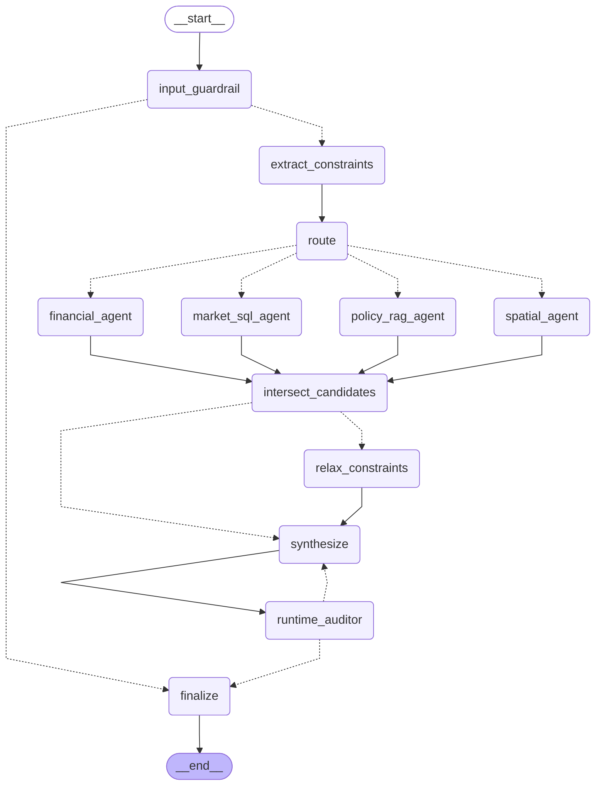
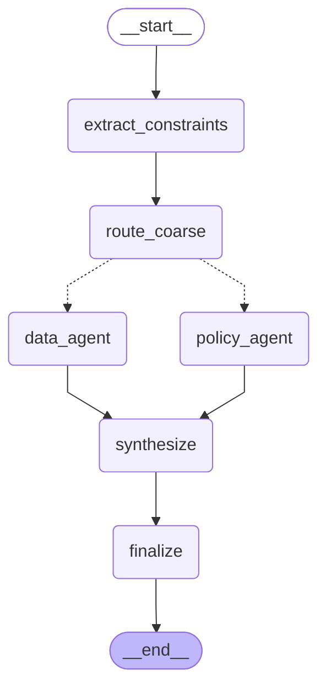
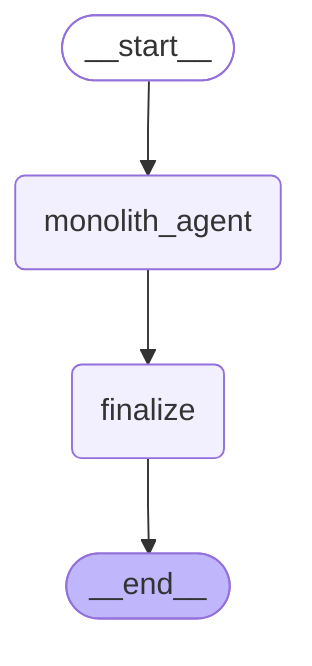

# HDB-Compass orchestration graphs (Member 4)

Generated from the compiled LangGraph objects (`graph.get_graph().draw_mermaid()`). Regenerate with `LLM_PROFILE=none .venv/bin/python docs/build_graph_diagrams.py`.

These are the drawings for the Lesson 12 whiteboard: Variant C is the one to reproduce from memory.

## Variant C — 5-agent specialist graph + runtime auditor (proposed)

Parallel `Send` fan-out from `route` to the four specialists; `intersect_candidates` joins SQL ∩ spatial on block key; `relax_constraints` runs only on an empty intersection (E2); `runtime_auditor` → `synthesize` is the self-correction cycle (≤2 retries).

## Variant B — coarse 2-agent split (baseline)

One combined Data/Spatial/Finance agent (10 tools) and one Policy agent (1 tool); no intersection node, no auditor.

## Variant A — monolithic ReAct agent (baseline)

One agent, all 11 tools, no supervisor, no auditor.

